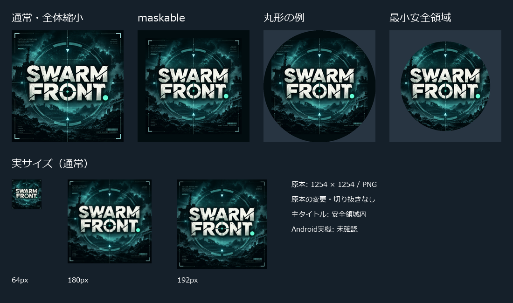

# PWAアイコンを本人提供のSWARM FRONT画像へ差し替え（2026-10-24）

状態: 実装SHA `6454379d0bfb41c4011e6cb5c0aba3e0f78178ff` をpushし、[PR217](https://github.com/futsalife24-bot/swarm-front/pull/217) を通常merge済み。mainは `9c5b68ae9e5493ceb0bb3be88d969c97d5f781f8`。アイコン限定の本番用branchを準備中。新規認証・権限追加なし。

## 対象と原因

Androidのホーム画面追加に月が表示されるという本人の依頼に対応。生成元が `assets/art/app-icon-user-20260918-moon.jpg` で、manifest/favicon/Apple用アイコンの全参照がそのv3生成物だった。本番v3・512pxを実際に取得・目視し、ローカル正本とSHA256一致を確認した。

本人が別途提示した [Drive原本](https://drive.google.com/file/d/1z3i3wONkSvQNtXipQraUuEswu9ShEw9d/view) を正規コネクタから取得し、1254×1254の青緑色のSWARM FRONTロゴと目視確認。原本のバイトは変更していない。出典・ハッシュ・生成方法は [原本の記録](../assets/art/app-icon-user-20261024.md)。

Library添付2枚の正規取得は、Windowsの属性保存API `os.setxattr` 非対応で失敗した。これは承認拒否ではない。本人が新たに提供したDrive経路で原本取得を解消した。Library版の画像・スクリーンショットを取得済みとは扱わず、Drive画像と本番の月画像を実際に確認した。

## 分離と変更範囲

- 基準main: `7cf9f0ebbefd2cdf361a90623efa10a6e26ab19a`（PR216 merge済み、GitHub読み取りで確認）。
- 専用branch: `codex/pwa-user-icon-20261024`。
- worktree: `C:/Users/futsa/Documents/Codex/2026-10-24/task/swarm-front-pwa-icon`。
- 元worktree `swarm-rebuild-p1a` は `claude/motion-toggle-balance-20261019` / `a3d8f076935620b2c264825bb3b849c544e2842f` と既存未コミット変更を保持。reset/stash/checkoutによる上書き、別候補の取り込みはしていない。
- 64/180/192/512pxの通常アイコンと512px maskableをv4名で追加。通常版は原本全体を縮小。maskableは四辺36pxの余白で主タイトルを安全領域へ入れた。
- manifestのicons、4枚のHTMLのfavicon/Apple参照、既存生成・検証scripts、既存PWA E2Eの該当期待値を更新。
- manifestのアイコン以外の全項目は基準とJSON比較で同一。idの省略、start_url/scopeの `./`、名称や表示モードを維持した。
- `src/`、`server/`、SW、セーブ、戦闘、依存のpackage/lockは無変更。新規インストールなし。依存は既存node_modulesを専用worktreeへコピーし、共有の依存へ書き込んでいない。

## キャッシュとmaskable

SWは従来どおり、HTMLナビゲーションとmanifestがnetwork-first、画像はcache-first。アイコン名をv4へ変更することで旧v3キャッシュと分離した。SW変更・登録解除・全オリジンのキャッシュ削除は行わない。

maskableの主要文字と緑の点を含む保守的な原本上の矩形 `x=150..1100, y=380..810` は、出力中心から最大188.477px。512pxアイコンの安全半径204.8px内に収まる。丸形と最小安全円で実画像も目視した。[W3Cの定義](https://www.w3.org/TR/appmanifest/#icon-masks) に従った確認であり、周縁の小文字や装飾まで全マスクで保持するものではない。

## 検証結果

| 確認 | 結果 |
| --- | --- |
| 原本SHA256、PNG読取、1254×1254 | 合格。原本SHA `7229dc0ab2eed9b0f518c2c32f3a123976b87a831ac573be1edf1aa0d3611b64` |
| 5出力の寸法・不透明性 | 合格 |
| 同環境で2回生成 | 5ファイルすべてSHA256一致 |
| client/worker型 | 両方合格 |
| 通常production build | 合格。既存の500kB超chunk警告あり |
| Pagesサブパスbuild | 合格。同警告あり |
| Worker production dry-run | 合格。431 assets、`--dry-run: exiting now`。公開なし |
| ローカルChrome、通常/旧playtest URL | 全PNG decode、installability errors 0、Apple 180px、manifest/HTML/5 PNGの7ファイル配信一致、health正常 |
| 旧v3キャッシュからの更新 | v4取得に成功。旧アイコン・別キャッシュ・検証専用localStorage値を保持 |
| 既存PWA E2E | 2/2合格。オフライン再読込とサブパスのmanifest/SW scope |
| 差分検査 | HTMLはアイコンURLだけ、manifestはiconsだけ。git diff --check成功 |

実行環境: Windows、Node 24.19.0、Chrome 155.0.8059.85、既存のPlaywright 1.63.0。生成のバイト一致はこの環境での反復確認であり、異なるChrome版まで同じバイトになると保証しない。

証拠: [画像検査](evidence/pwa-icon-20261024/image-checks.json)、[ブラウザ検査](evidence/pwa-icon-20261024/local.json)、[E2E要約](evidence/pwa-icon-20261024/e2e-summary.json)。

初回の既存検証は廃止済み `#home-developer` の待機で失敗したため、実画面と現行ソースを確認して `#solo` へ修正。旧E2Eの `icon.svg` と「ソロで出撃準備」も現manifest/実UIと一致していなかったため更新した。合格基準の削除はしていない。隔離E2E設定の相対パス誤りと、サンドボックス内localhostの接続拒否/timeoutは解消後に再実行し2件成功。ゲームコードの回帰とは扱わない。

## 再現

repoルートで以下を実行する。既存作業のポートを使用しない。

1. `node scripts/build-pwa-icons.mjs`
2. `npm run typecheck`、`npm run build:production`、`npm run build:pages`、`npm run server:build:production`
3. ローカル検証Worker: `node node_modules/wrangler/bin/wrangler.js dev --local --config wrangler.production.jsonc --ip 127.0.0.1 --port 5354 --inspector-port 9364 --persist-to dist-validation/pwa-icons/worker-state`
4. `node scripts/check-pwa-icons.mjs`（既定の接続先5354、検証専用Chromeプロファイル）。
5. Pagesプレビューは5365。既存 `e2e/pwa.spec.ts` をbaseURL=5354の隔離設定で実行し、`PWA_PAGES_URL=http://127.0.0.1:5365/swarm-front/` を渡した。通常のテスト設定では4186の既定値を維持。

## 未確認と公開条件

- Android実機の追加画面、既にインストール済みのWebAPKが更新される時期・表示は未確認。実スマホ確認済みとは報告しない。
- 本番は今回変更していない。作業前の本番index SHAは10月19日公開記録と一致し、v3の月アイコンを配信。PR216のmain反映と本番公開は区別する。現在のWorker Versionは今回照会していない。
- 今回のpush・merge・公開禁止が解除された後、最新mainとの競合確認、通常PR/CI/merge、merge後のbuild、既存Worker公開、配信ハッシュとAndroidの実表示確認が必要。
- Cloudflareの認証状態は公開再開時に確認する。認証が必要なら、新規認証禁止を解除する本人指示が必要。キャッシュや保存データの一括削除でアイコンを直そうとしない。

## アイコン限定の公開準備（2026-10-24）

本人の11:45 JST「公開して！」を受け、今回のアイコン変更だけのpush・main反映・既存Worker公開を再開。既存Wrangler認証とDashboardセッションで確認し、新規認証・権限追加は行っていない。

- GitHub実装SHAのpush後照合、PR217通常mergeを確認。対象SHAのcheck-runsは0件、status contextsも0件、PR mergeStateはCLEAN。CIは未設定であり、CI合格とは扱わない。管理者バイパスなし。
- 公開前のWorker Versionは `57f36bd8-d3d9-4df9-9590-4b54fa593e96`（2026-10-19、100%）。本番ソースは `a9ede4d94c8947257287f12770ee72c56acc5375`。HTTPでv3の月アイコンと旧indexを再確認。
- mainのPR216には、入力解除、味方のミニマップ表示、演出配列の処理という未公開の3ファイル差分（+29/-11）がある。今回は配信範囲外なので含めない。mainの変更をrevertしない。
- 公開用branch `codex/pwa-icon-only-release-20261024` は本番ソースa9ede4dを基準に、PR217のアイコン関連20ファイルと専用の状態記録だけを反映。`src/`・`server/`・SW・依存・Wrangler設定は本番基準と同一。通常のmain HEADからの公開と異なるのは、今回の本人指定がアイコンのみのため。公開SHAを別途追跡する。
- DashboardでWorkers Free / $0 / Current planを確認。アカウント全体の当日Requestsは60 / 100,000、当月8.72k、CPU 5.79k ms。DO使用量は未取得。契約変更なし。
- 本番用branchのビルド・dry-run・公開後配信確認は、以下の結果記録で個別に確認する。Android実機は未確認。キャッシュ削除、SW解除、セーブデータ変更は行わない。
