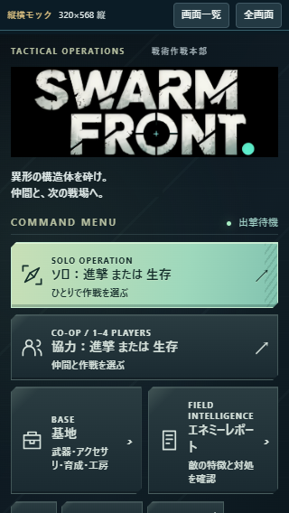
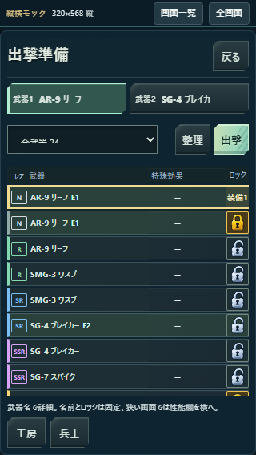
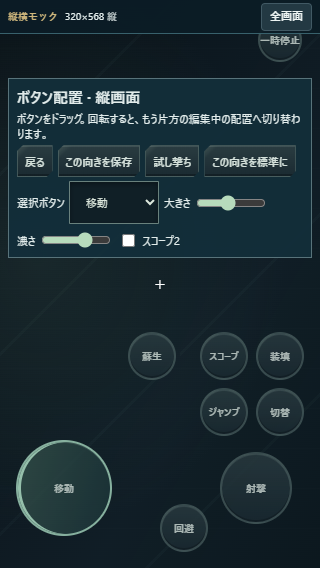
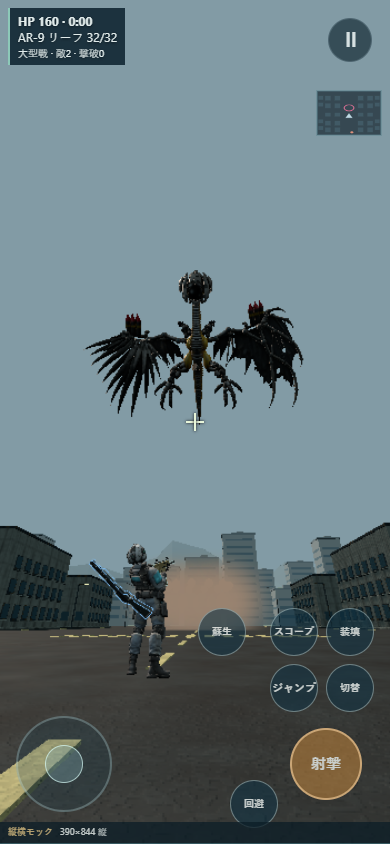
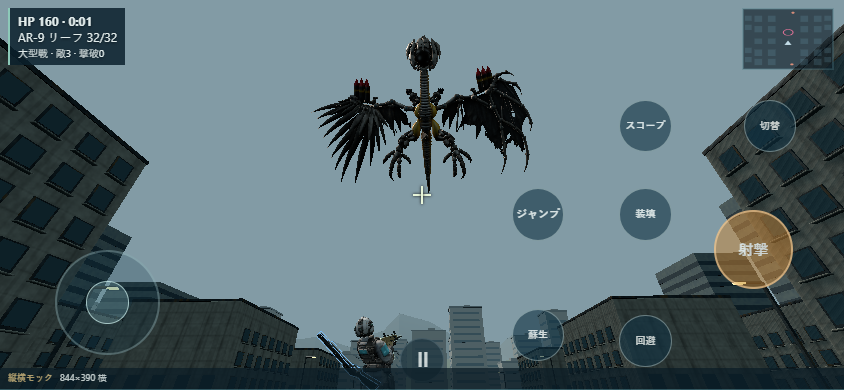
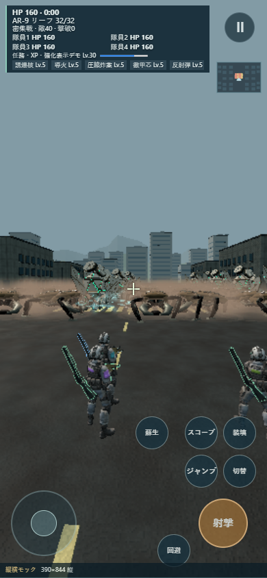
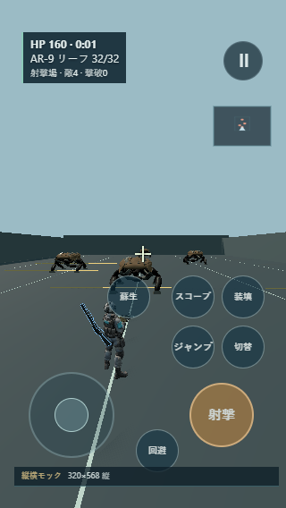

# 縦横モックの検証証拠

2026-10-23、Windows Chrome（携帯表示・タッチ有効）、基準main `7cf9f0ebbefd2cdf361a90623efa10a6e26ab19a`。実装と再現手順は [仕様・記録](../../ORIENTATION-MOCK.md)。画像は生成イメージではなく、配布用ビルドの実ブラウザ画面。

- `screens.json`: 36メニュー系画面の巡回。
- `isolation.json`: 全6シナリオの禁止通信・本編保存アクセス・SW等の集計。通信を拒否した時点で失敗として数える。
- `input.json`: 三点タッチ前後、回転後、ポーズ後の読み取り診断値。
- `trial.json`: 試し撃ち前後のrun、時間、プレイヤー、敵HPの一致と、縦側だけの保存。
- `gear-baseline.json`: 4幅×通常／整理の30px行・28pxロック・20px見出し・武器名幅・横スクロール検査。
- `build-isolation.json` / `module-graph.json`: 配布素材の明示許可・未公開6件の除外・本編bootstrapや通信入口を含まない依存グラフ。
- `delivery.json`: **ローカル**配信の6ファイルSHA一致と、API/SW/manifest等5経路の404。公開版の確認ではない。
- `account-before.json`: 秘密情報を含めない契約確認結果。CLI認証は利用可能、契約API403、Dashboard未ログイン。本番Versionを読取記録。

単体32件・型・モックbuild・通常build・Worker dry-run通過。E2E6件通過後、大型戦の初期位置／視点変更に対応する戦闘表示テストを再実行し通過。大型敵のロード完了を待って撮影した。既存aim/render失敗2件は基準SHAの独立抽出でも再現したため今回の変更では修正していない。

## 実画面

Android実機・物理回転ロック・実ジャイロ・回線速度・実聴は未検証。スクリーンショットやWindowsのタッチ再現を実機の手触り評価の代わりにはしない。
