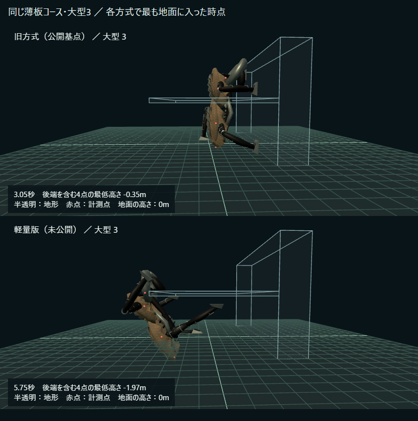

# PLEAT 公開前の受入確認（2026-11-01）

## スマホ向けの結論

現状のままの公開は推奨しない。大型の胴体侵入と、床→壁の移行中に攻撃を抑止する時間の差を再現した。ゲーム本体は未変更、merge・公開も未実施。

- 大型3の後端は、旧方式で地面から最大0.35m下、軽量版で最大1.97m下に達した。
- 大型2.25では薄板自体への接触も残る。単なる「足の見た目」ではない。
- 床→壁の攻撃抑止フラグは、旧方式の1.35〜1.45秒から軽量版の0.75秒へ短くなる（下記コース、20Hzサンプル）。実際の攻撃開始・被弾には距離・高低差・視線・クールダウンも必要で、被弾増加を証明した計測ではない。
- 狭所では胴体を低く保ち、空間へ出てから姿勢を変える案を本人へ提示中。経路・所要時間を変えるため、仕様判断の返答前には実装しない。

[スマホ用比較画像](phone-comparison.png) / [比較動画（MP4、約0.5MB）](phone-comparison.mp4)



画像は各方式の地面侵入が最大だった時点（同じ時刻ではない）。動画は旧方式→軽量版の順。20Hzの計測状態を、両方とも現在のモデル・足描画で再生している。地形は侵入箇所を見やすくするため半透明。旧端末の足描画や実戦画面の比較ではない。スマホ向けに844×390で撮影したPC Chromeの結果で、実スマホの性能検証ではない。

## 対象と保存場所

- GitHub: https://github.com/futsalife24-bot/swarm-front
- 旧方式: main基点 `3035376932bbf3e0734e181b7040827bf033b80d`。
- 軽量版: PR #245 / #246を含む `640de79613c585c22c0b06e696942ed357af359e`。移動コードはPR #245 HEADと同一。
- 担当branch: `codex/pleat-wall-acceptance-20261101`、baseは上記640de79。
- 担当worktree: `C:/Users/futsa/Documents/Codex/2026-10-02/github/swarm-rebuild-p1a/task-pleat-acceptance`。
- 元root、dist-h、Claudeのworktree、通信担当worktreeを変更していない。主担当の実モデルID・推論設定は未確認、子なし。

## 同条件の再現

既存の壁コース5種類、4サイズ（1.2 / 1.5 / 2.25 / 3）、旧新2方式の計40走行。dt=0.05秒、入力は現在の進行方向、上限60秒。全40走行で到達・有限座標を確認。胴体の頭・胸・外套・後端の4代表点を測定し、0.02m以上の侵入を記録する。全メッシュや脚の体積の衝突検査ではない。

薄板コースは地面0m、板下面4m、板上面4.3m、背後の壁8m。旧記録の `ticksWithBodyPointInsideSolid` は実際には点ごとの回数で、同一tickの重複を含んでいた。今回、点サンプル数と重複を除いたtick数を分離した。旧記録は履歴として保持。

| サイズ | 方式 | 侵入点サンプル | 侵入tick | 地面 / 板の点サンプル | 最低点の高さ |
|---|---|---:|---:|---:|---:|
| 2.25 | 旧 | 6 | 6 | 0 / 6 | 地面侵入なし |
| 2.25 | 軽量 | 12 | 12 | 10 / 2 | −0.476m |
| 3 | 旧 | 27 | 26 | 18 / 9 | −0.353m |
| 3 | 軽量 | 38 | 34 | 38 / 0 | −1.967m |

他の4コース、および薄板の1.2/1.5は今回の4点検査で侵入0。現行の単体テストの薄板コースは1 / 1.5のみで、大型2.25 / 3のこの問題は対象外だった。

原因の切り分け: 現行 `keepClear` は接触中の面と縁の相手面（および直前の面）を解析的に扱うが、別の床・上方の薄板を同時に保証しない。さらに垂直姿勢では代表点の前後長だけでも `2.258 × scale`（大型3で6.774m）あり、高さ4mの隙間内でそのまま回転できない。単純な地面への押し戻しだけでは別の面への侵入や跳ねを生む可能性がある。姿勢・移行経路の設計が必要。

## 攻撃不可時間の訂正

床→壁→屋上コースの最初の床→壁を切り出した。時刻は20Hzでの最初のフラグtrueから最初のfalseまで。コース全体の合計は、最後の面へ到達した時点で打ち切られるため、最後の整姿勢時間を含まない。これを1つの縁の差として割り算してはいけない。

| サイズ | 旧・攻撃抑止 | 軽量・攻撃抑止 | 差 |
|---|---:|---:|---:|
| 1.2 | 1.35秒 | 0.75秒 | −0.60秒 |
| 1.5 | 1.40秒 | 0.75秒 | −0.65秒 |
| 2.25 | 1.45秒 | 0.75秒 | −0.70秒 |
| 3 | 1.35秒 | 0.75秒 | −0.60秒 |

新しい面へ切り替わった後のsettlingだけなら旧約0.35秒、新0.40〜0.45秒。短くなった主因はその前の移行本体。凸の屋上縁では逆に旧約1.35〜1.45秒→新約1.8秒となる例がある。一律の待ち時間加算では両方を揃えられない。ゲーム側の判定は `src/shared/game.ts` の `!transfer && !settling` だが、今回の再現は実戦の被弾数測定ではない。

## 再実行

```powershell
npx --no-install vitest run --config scripts/vitest.pleat-acceptance.config.ts
npx --no-install vitest run tests/pleat-locomotion.test.ts
npm run typecheck
```

比較用の旧controllerはGitの上記SHAから生成し、gitignore対象の `scripts/.acceptance-courses` に残す。既存資料の結果は上書きしない。詳細は [wall-courses.json](wall-courses.json)。4つの `slab-*.json` は描画用の時系列。生成スクリプトと検証用ページはscriptsに保存。

## 検証と残件

- 新しい再現1件（40走行・到達と有限座標）成功。これは侵入ゼロの合格ではなく、不具合の再現と記録の成功。
- 既存の移動テスト11件成功。大型薄板は既存対象外。
- 型チェック成功。検証ページもVite型定義を指定した単独型チェックで成功。
- PC Chromeで4場面を描画・画像確認、ページ例外0。比較動画はH.264 / yuv420p / faststartで保存。
- ゲーム本体無変更のためビルド・通信回帰一式は再実行していない。既存PRの検証を今回の修正合格と扱わない。
- 修正未実装。実スマホ、実回線協力、GPU負荷、長時間、実戦の攻撃/被弾は未確認。745msの原因やラグ解消は判断していない。
- 次は狭所姿勢・移行の仕様判断に応じた修正、その後に大型を含む侵入ゼロ・移動継続・姿勢の連続性・攻撃抑止・サーバー負荷を再測定する。難易度調整は別変更。

### 画像・動画の再生成

Viteを `127.0.0.1:5188` で起動後、`node scripts/capture-pleat-wall-acceptance.mjs` と `node scripts/package-pleat-wall-review.mjs` を実行。中間webmはgitignore対象。MP4変換は以下。

```powershell
ffmpeg -i docs/evidence/pleat-wall-acceptance-20261101/before.webm -i docs/evidence/pleat-wall-acceptance-20261101/lightweight.webm -filter_complex "[0:v]fps=20,setsar=1[v0];[1:v]fps=20,setsar=1[v1];[v0][v1]concat=n=2:v=1:a=0[v]" -map "[v]" -c:v libx264 -preset fast -crf 23 -pix_fmt yuv420p -movflags +faststart docs/evidence/pleat-wall-acceptance-20261101/phone-comparison.mp4
```

検証環境で最初のChrome読込は権限環境の不一致・Vite初期読込待ちで失敗した。サーバーとChromeを同じ実行環境に揃え、HTTP 200を確認後、初期読込を120秒まで待つ設定で取得成功。ブラウザ全体の恒久復旧や実機接続の確認ではない。
