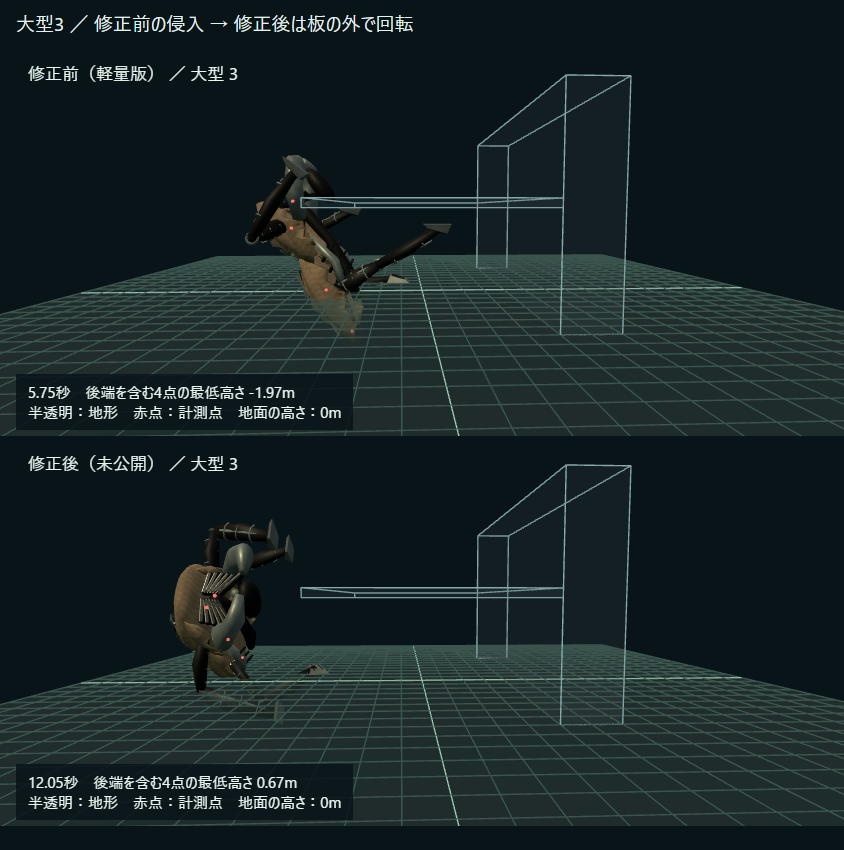

# PLEATの狭所姿勢と壁移行の修正（2026-11-01）

## スマホでの確認

[修正前後の比較画像](phone-comparison.png) / [比較動画（MP4、約30秒・0.69MB）](phone-comparison.mp4)



大型は低い姿勢で板の下を通り、後端まで板の外へ出てから立ち上がって上へ登る。4サイズ×5コースの修正後20走行で、胴体4代表点の侵入0・到達・姿勢待ち解除を確認した。**全メッシュ・全地形の無衝突保証ではない。**

動画は修正前軽量版→修正後の順。画像はそれぞれの問題箇所と回避動作を切り出しており、同じ時刻・位置ではない。地形は接触を見やすくするため半透明。20Hz計測状態をPC Chromeで再生したもので、描画待ちを含む動画尺とシミュレーション秒数は一致しない。実スマホ・実回線の性能確認ではない。

## 承認・Git

- 本人の「はい」により、狭所で低い姿勢を保ち空間へ出てから姿勢変更する方針（経路・所要時間への影響を含む）を承認。merge・本番公開は未実施。
- [PR #247](https://github.com/futsalife24-bot/swarm-front/pull/247) に修正を追加。実装commitは `66ec4e9d07ed77473eb465bc9c38fbb28b518f76`。PR #246のbranchがbase。
- branch: `codex/pleat-wall-acceptance-20261101`。branch base: `640de79613c585c22c0b06e696942ed357af359e`、修正着手前HEAD: `1c5230b2c87b3d79dc7b26f57dc9e118dd07d9d0`。
- worktree: `C:/Users/futsa/Documents/Codex/2026-10-02/github/swarm-rebuild-p1a/task-pleat-acceptance`。元root・dist-h・Claude・通信担当の既存差分は保持。
- 主担当の実モデルID・推論設定は未確認。子なし。自己検証であり独立監査ではない。

## 変更ファイルと目的

- `src/shared/pleat-locomotion.ts`: 低い天井の検出、水平姿勢維持、板外への退避→姿勢変更→面移行の保存可能な段階処理。実際の胴体位置から曲線を開始する。面移行周辺だけ胴体4点への短いレイで第三の床・天井を確認し、無理な姿勢を保留。移動・角速度を制限する。侵入済み旧保存姿勢は制限速度で外へ戻す。
- `src/shared/game.ts`: `poseHeld` 中は新しい攻撃予告を開始しない。
- `src/shared/enemy-motion.ts`: `poseHeld` 中はプレイヤーが近くても面移行のための移動を止めない。
- `tests/pleat-locomotion.test.ts`: 薄板の既存テストへ大型2.25 / 3を追加し、胴体の登頂と姿勢待ち解除まで確認。
- `tests/pleat-clearance.test.ts`: 2サイズ×2向き×3更新間隔（1/60・1/20・1/10秒）、連続性、侵入、移行途中のJSON保存復帰を検査。旧版の侵入姿勢を初速0で復元した場合の回復も検査。
- `tests/pleat-combat-clearance.test.ts`: 実際のgame.stepで、近くにプレイヤーがいても姿勢変更を継続し、姿勢変更中の攻撃抑止・整姿勢後の攻撃再開を検査。
- `scripts/pleat-wall-fix.test.ts` / `vitest.pleat-fix.config.ts`: 旧四足・修正前軽量・修正後の60走行を同条件で計測。
- `scripts/measure-pleat-clearance.test.ts` / `vitest.pleat-clearance-load.config.ts`: 96体のサーバー負荷比較。
- `scripts/pleat-wall-fix-review.*` / `capture-pleat-wall-fix.mjs` / `package-pleat-wall-fix.mjs`: 実モデルでの比較画像・動画再生成。
- `.gitignore`: 中間webmのみ除外。`docs/STATE.md` と本資料に現在地・証拠を記録。

HP・攻撃力・敵数・通常速度設定・ボス・他ANOMALYは変更していない。通信形式・能力交渉・差分・ACK・分割・復旧も変更していない。新しい状態はサーバーの保存に含まれ、wireへは従来と同じ姿勢だけを送る。

## 同条件の結果

地面0m、板下面4m・上面4.3m、入力は進行方向、dt=0.05秒。到達後は入力速度0で整姿勢まで待つ。侵入は既存と同じ4代表点を0.02mの余裕で検査し、点サンプルと重複を除いたtickを区別する。単体回帰はさらに0.001mの基準で確認。[全60走行](wall-courses.json)。

| 薄板のサイズ | 方式 | 侵入点サンプル / tick | 登頂まで | 整姿勢まで | 接地探索/秒 |
|---|---|---:|---:|---:|---:|
| 2.25 | 旧四足 | 6 / 6 | 9.70秒 | 10.05秒 | 1,407 |
| 2.25 | 修正前軽量 | 12 / 12 | 9.35秒 | 9.75秒 | 88 |
| 2.25 | 修正後 | 0 / 0 | 16.00秒 | 16.45秒 | 262 |
| 3 | 旧四足 | 27 / 26 | 8.05秒 | 8.40秒 | 1,402 |
| 3 | 修正前軽量 | 38 / 34 | 8.15秒 | 8.55秒 | 74 |
| 3 | 修正後 | 0 / 0 | 15.60秒 | 16.05秒 | 274 |

大型の薄板通過は約6.7〜7.5秒長くなる。小型1.2 / 1.5でも凹角の移行時間を戻したため、薄板の登頂は12.40→13.70秒 / 11.50→12.80秒。通常の速度設定の変更ではなく、面移行と退避経路の時間差である。低い段差コースの到達時間は修正前軽量版と同じ。

床→壁の攻撃抑止は、旧四足1.35〜1.45秒・修正前軽量0.75秒に対し、修正後は4サイズとも1.40秒。凹角の移行本体に最低1秒を確保した。凸の縁は代表コースで1.8秒で、修正前軽量版と同じ。旧四足方式の全ケースとの完全一致ではない。狭所姿勢中も抑止するため、実戦の攻撃・被弾差は別途確認が必要。

## 負荷の代償

[server-load.json](server-load.json): 都市seed11、96体、20秒、同じ歩行入力。両方式を1回ずつウォームアップし、順序を交互にして各3回計測。

| 指標 | 修正前軽量 | 修正後 |
|---|---:|---:|
| サーバーtick中央値 | 3.70〜4.09ms | 3.85〜4.06ms |
| tick p95 | 6.60〜7.84ms | 7.44〜8.59ms |
| 接地探索/体/秒 | 157.2 | 157.2 |

この通常配置で速度改善とは言わない。p95は増えている。狭所を集中的に通す薄板コースの大型では上表の通り88→262、74→274回/秒へ増加する。旧四足方式の約1,400回/秒へは戻していないが、壁に群れが集中する実戦負荷は未確認。PCの結果をスマホ快適化や745msの解消として扱わない。

## 検証

- 関連単体・統合174件成功（PLEAT、敵、wire、tuple、delta、分割、delivery、receipt）。
- 60走行の比較1件成功。修正後20走行は侵入0・到達・整姿勢完了・移動量上限をassert。
- 96体の比較1件成功。型チェック、比較ページの単独型チェック成功。
- PC Chromeの修正前・低姿勢・外側回転・登頂を844×390で確認、ページ例外0。[描画記録](visual-check.json)。既存シェーダーのコンパイル警告はあり、警告ゼロという意味ではない。
- 実装commit `66ec4e9d07ed77473eb465bc9c38fbb28b518f76` からクライアントbuild / Worker dry-run成功。Worker dry-runは455.95KiB（gzip116.66KiB）。クライアントの大きいchunk警告は残る。GitHub CIは未確認で、ローカル成功をCI合格とは扱わない。

## 未確認と適用限界

実スマホ、実回線協力、長時間、GPU、大量の壁越え同時発生、実戦の被弾数、全マップ・全隙間の形状は未確認。狭所検出は上下のほぼ水平な面を対象にする。4点検査と目視であり、足・外套の全頂点を含む厳密な体積衝突ではない。足は引き続き端末演出で、旧端末向けの互換feetも維持。

## 再実行

```powershell
npx --no-install vitest run --config scripts/vitest.pleat-fix.config.ts
npx --no-install vitest run --config scripts/vitest.pleat-clearance-load.config.ts
npx --no-install vitest run pleat state-wire state-tuples state-delta state-chunks state-delivery state-receipt enemies
npm run typecheck
npm run build
npm run server:build
```

画像はViteを127.0.0.1:5188で起動後、`node scripts/capture-pleat-wall-fix.mjs`、`node scripts/package-pleat-wall-fix.mjs`。中間webmからMP4へは以下。

```powershell
ffmpeg -i docs/evidence/pleat-wall-fix-20261101/previous.webm -i docs/evidence/pleat-wall-fix-20261101/fixed.webm -filter_complex "[0:v]fps=20,setsar=1[v0];[1:v]fps=20,setsar=1[v1];[v0][v1]concat=n=2:v=1:a=0[v]" -map "[v]" -c:v libx264 -preset fast -crf 23 -pix_fmt yuv420p -movflags +faststart docs/evidence/pleat-wall-fix-20261101/phone-comparison.mp4
```
