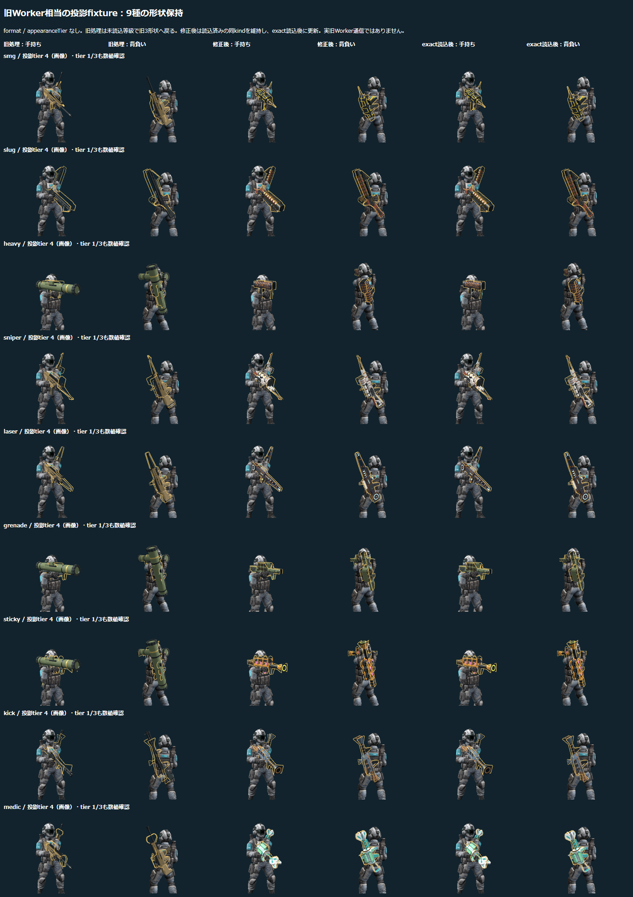

# 旧Worker相当の融合投影による形状退行の局所検証

2026-11-12。独立監査 P2-01 の修正確認。実旧Workerへの通信は行わず、`format` と `appearanceTier` を省いた明示的な投影fixtureを、製品の `StandardTrooper`、GLBローダー、WebGL描画へ入力した。

## 比較対象と再現

- 旧処理: `c4fce32fa7ff00d3e0d6186f10c568a69bd7b25a` の `src/client/progression-weapons.ts` だけを `git show` で取得し、検証bundle内で差し替えた。他の製品モジュールは両側とも同じ作業ツリーのものを使用した。旧HEAD全体のブラウザー試験ではない。
- 修正後: 上記HEADに対する未コミット修正。対象ソースのSHA-256は `90266a756a1d224406894079a5a6c833afaa90891aa8cf5290b21292565bf24e`。検証の前後で同一ハッシュを確認した。
- 実行: `node scripts/check-weapon-tier-fallback-browser.mjs`。構文確認 `node --check scripts/check-weapon-tier-fallback-browser.mjs` も成功。
- 実装・検証用スクリプト以外の製品ファイルを書き換えず、ローカルHTTPとChromeで実行した。SWはこの局所検証では無効化し、モデル選択と描画に対象を限定した。

## 条件と結果

対象は `smg / slug / heavy / sniper / laser / grenade / sticky / kick / medic` の9種類。最初に各kindの現行形式tier 0を読み込み、同じkindを手持ちと背負いに装備。その後、`{id, kind, rarity, power: 1, effect: 'none'}` の投影fixtureでrarityを `0 → 2 → 4` と変え、製品コードが求めるvisual tier `1 → 3 → 4` を順に検査した。

| 検査 | 結果 |
| --- | --- |
| 旧処理・未読込tierを要求 | 9種類×3条件の27条件すべてで、両枠が既存のrifle/shotgun/rocket形状へ戻ることを再現 |
| 修正後・同じ投影 | 27条件すべてで、両枠が読み込み済みの同kindの形状を維持 |
| exact tier 4を追加読込 | 9種類すべてで、同じ投影を維持したままexactモデルへ切替。両枠のgeometry参照一致と手持ち装備cloneの更新を確認。旧処理側でもexact読込後は同kindになることを確認 |
| 取付先 | 手持ち `RightHandWeaponSocket`、背負い `BackWeaponSocket_2` を全段階で確認 |
| ページ例外・HTTP/取得失敗・WebGLエラー | 旧処理・修正後とも0 |

形状の機械判定には、ネオン縁取りを除いた各meshのgeometry参照を使用した。GLBのcloneが元モデルとgeometryを共有することを利用し、名称や画面の色だけで判定していない。読み込んだ22資産の相対パス・サイズ・SHA-256、各段階のsource/geometry参照とsocketは[詳細レポート](tier-fallback-browser-report.json)に収録した。

## 画像と確認範囲

画像は各kindの投影tier 4を9行×6列の1枚へまとめた。左から旧処理の手持ち・背負い、修正後の手持ち・背負い、exact読込後の手持ち・背負い。目視でも、旧側の共通形状への退行と、修正後の9種類の形状維持を確認した。tier 1/3は数値確認のみ。exactへの切替は画像だけでなくsource/geometry参照とclone更新で確認した。

この試験は実旧Worker通信、通常ゲームUI全体、連続アニメーション、実スマホ、手や体への接触、射撃線・銃口位置、音・負荷の再検証ではない。旧Workerで等級色の扱いが変わる既知制限は残る。SWキャッシュの検査も別の証拠に委ねる。
